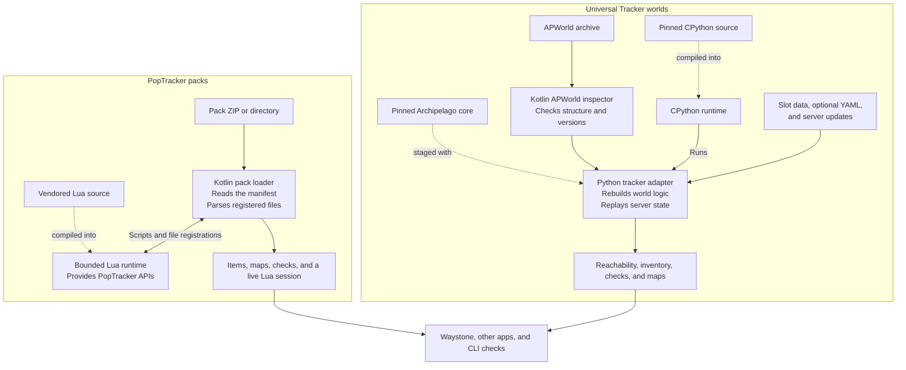

# PackSanity

PackSanity owns a standalone extraction of Waystone's PopTracker pack and Universal Tracker
APWorld loading layer. It contains the registration-driven Kotlin parser/models, bounded native
Lua 5.4.9 host, tracker-only Python reconstruction adapter, and developer integration commands.
No application checkout, UI, Android SDK, catalog, or Archipelago server is needed.

## How PackSanity works



## Try a pack or world

```sh
./test-pack.sh /path/to/development-pack.zip
./test-pack.sh /path/to/pack-directory --all-variants --json
./test-pack.sh /path/to/pack.zip --variant standard --fixture tests/scenarios/example-pack.json

./test-world.sh /path/to/development_world.apworld --slot-data /path/to/slot-data.json
./test-world.sh /path/to/world.apworld --yaml /path/to/player.yaml --fixture /path/to/scenario.json --json
```

A pack check parses the manifest, executes Lua in a disposable discovery session, parses **exactly
the files the chosen variant registers**, then initializes a fresh native session. It runs frame
handlers, checks callback errors and highlight target identities, reparses callback-driven
registrations, and reports items, maps, sections, location-ID mappings, unresolved references and
diagnostics. Scenario fixtures can replay Archipelago callbacks and assert provider counts, hint
highlights, location mappings and other loading results. `--strict` makes diagnostic/reference/
image problems fail a development check. Both ZIP and unpacked directory development packs work.

A world check runs the Kotlin APWorld structural/version gate, imports the selected archive into
an isolated Python process, then runs the actual tracker-only fake-generation stages and state
updates. Use real server `slot_data` and the original YAML when required by that world's hooks;
an empty object cannot reconstruct every game/seed. Missing YAML, dependencies, incompatible
versions and failed reconstruction are failures, not skips. Multi-game archives require `--game`.
`--external-pack PATH` attaches a companion PopTracker map ZIP. The checker verifies returned map
image paths against the actual archive. It does not run desktop UT, fill a seed, or connect to AP.

See [verified extraction checks](docs/verification.md) and [testing and scenarios](docs/testing.md) for input formats, examples, pass criteria and limits.
A passing load is integration evidence, not a certification of every gameplay rule or every seed.
APWorlds execute Python code: test archives you trust, in a disposable environment for outside
submissions. Python process/import isolation is not a filesystem/network sandbox. Lua has a
bounded memory/instruction sandbox with only read-only registered pack files.

## Setup and regression tests

Use a full JDK 21, a C compiler, Make, Meson 1.3+, Ninja, Git, and a bootstrap Python 3
with pip. Pack checks compile the vendored Lua 5.4.9 sources locally. World checks fetch
and verify AP 0.6.8 and CPython 3.13.15 and stage the locked pure-Python dependencies in
`build/python/`. The first world check also compiles CPython into `build/python/host/`.
Later runs reuse that build. The APWorld command executes that interpreter in isolated mode.
`PACKSANITY_PYTHON` selects the bootstrap Python used for fetching and staging.
On macOS the build picks up Homebrew's OpenSSL 3 when available. Set `PACKSANITY_OPENSSL`
to the prefix of a compatible OpenSSL install to override detection.
See [runtime.lock.json](python/runtime.lock.json) for the source pins.

```sh
./gradlew spotlessApply :loader:jvmTest
make test
python=$(python3 python/tools/prepare_runtime.py)
"$python" -m unittest discover -s python/src/test/python
"$python" tests/test_integration.py
make python-native
```

Meson builds PackSanity's native targets, CPython uses its upstream build, and Kotlin uses
Gradle. Install Meson and Ninja with your package manager or with pip in a virtual environment.
`make test` uses `build/meson` and `test-pack.sh` uses `build/native-meson` with JNI enabled.
`make python-native` compiles the C bridge against the locally built CPython in
`build/python-native-meson`.
These paths avoid reusing obsolete native build caches. Configure options include `-Djni=true`,
`-Dpython_bridge=true`, `-Dpython=/path/to/python3.13`, `-Dtests=false` and
`-Ddefault_library=shared`. Both optional bridges default off. JNI requires a full JDK in
`JAVA_HOME`. `make` accepts `BUILD_DIR`, `MESON`, `MESON_ARGS`, `MESON_BUILD_ARGS` and
`INSTALL_ARGS`; for example `make test MESON_ARGS='-Ddefault_library=shared'`.

`test-pack.sh` and `test-world.sh` return nonzero for failed loads/assertions. Build progress and
pack log output go to stderr; `--json` stdout is machine-readable. Run either command from any
working directory, including a path containing spaces. Local development archives stay outside
Git. The synthetic fixtures and regression suite live here and use only local test helpers.

## Library boundary

- `loader/`: a Kotlin Multiplatform library containing archive contracts/safety, JSONC parsing,
  pack models/rules, dynamic Lua registration/session loading, APWorld inspection, and the typed
  JSON runtime contract. The default artifact is JVM; `-PenableIos=true` enables arm64 iOS and
  simulator library targets. It has no Compose, Koin, Ktor or Android dependency.
- `native/`: public `packsanity/lua_host.h` and `packsanity/python_host.h` C ABIs, Lua sources,
  JNI adapter, and the shared CPython host. Networking, application persistence and UI belong to
  consumers. Native APIs expose values/JSON and owned strings, not interpreter objects.
- `lua/poptracker_host/`: ordered host fragments compiled into the Kotlin artifact as one chunk.
  `lua/host.lua` retains a plain bootstrap for C consumers and host conformance tests
  with epoch 0; Kotlin sessions substitute the current epoch into the same fragment source.
- `python/src/main/`: owned reconstruction/source adapters and narrowly scoped runtime templates.
  `python/tools/`: lock/bootstrap/staging support independent of platform app builds.
- `cli/` and `tools/`: integration clients of the library, not alternate pack implementations.

Use `./gradlew :loader:publishToMavenLocal` for a local Kotlin consumer, then add
`implementation("dev.nattle.packsanity:loader:0.3.0-SNAPSHOT")` with `mavenLocal()` enabled.
Native consumers install with `meson install -C build/meson` and use pkg-config packages
`packsanity-lua` and (when enabled) `packsanity-python`. Meson consumers use
`dependency('packsanity-lua', static: true)` for the default static library. C and C++ headers expose
opaque runtime handles. Create a
`PackSanityPackParser` and `LuaTrackerPackageLoader`, supply a `PackageArchive` and
`LuaPackRuntimeFactory`, and retain/close the returned session. JVM clients can use
`NativeLuaPackRuntime`; mobile clients link the same C host through their platform adapter.
APWorld clients use the typed `EmbeddedUniversalTrackerRuntime` with a
`UniversalTrackerJsonRuntime`, or the Python `MobileUniversalTracker` API and C JSON bridge.
Calls must be serialized. Each C handle owns a subinterpreter. Close that handle and create a new one to switch
APWorld archives. The command-line Python runner uses a single world per process.

PackSanity owns its library contract independently of consuming applications.
[Extraction provenance](docs/provenance.md) and `extraction-manifest.json` record the source
revision and extraction adjustments. Custom manifest keys use `min_packsanity_version`,
`target_packsanity_version`, `min_packsanity_compatibility_level` and
`target_packsanity_compatibility_level`. Legacy Waystone keys are accepted as fallbacks. PackSanity keys take precedence when both are present. Override archives are supplied by
callers; PackSanity does not select an application-specific override filename.

See [compatibility boundaries](docs/compatibility-matrix.md)
and [third-party notices](THIRD_PARTY_NOTICES.md) before distributing a library or runtime bundle.

See [building and consuming releases](docs/releasing.md) for the Maven and native bundles.
The [Waystone migration plan](docs/waystone-migration.md) covers the downstream cutover.
